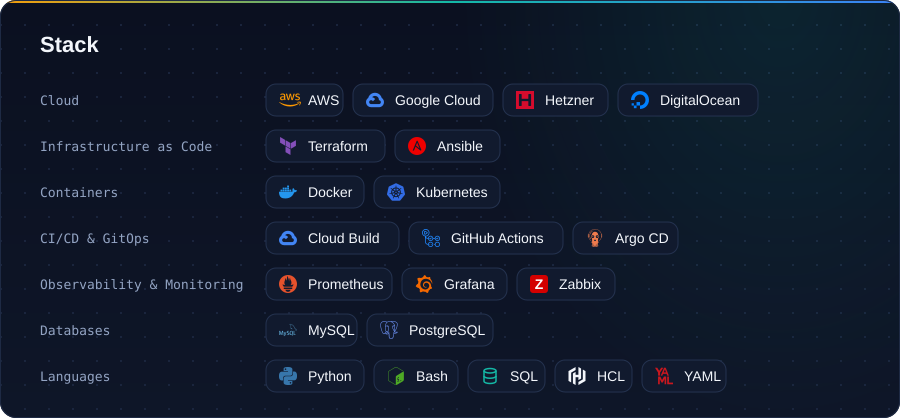

I build and automate cloud infrastructure on **AWS** and **Google Cloud**: Terraform-managed environments, CI/CD pipelines, and containers on ECS and Kubernetes. I apply **DevOps culture practices** (automation, infrastructure as code, continuous delivery, monitoring and shared ownership) to make environments more reliable, repeatable and faster to ship to.

  &nbsp;&nbsp;
  

